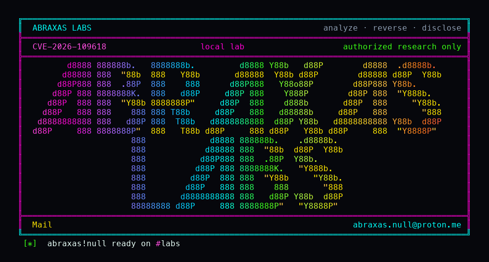

<p align="center">
  
</p>

# php-oom-longjmp

Someone on the internet can talk to your PHP site the same way a browser does, with no password. On last-affected PHP they can send a crafted file-upload request that makes the engine run out of memory while it is still reading the request, before your application starts. PHP then jumps out of that work with the request only half built. The PHP Group showed that cleanup of that half-built state can become remote code execution as the web worker. This lab proves the out-of-memory jump on Apache mod_php 8.4.26 and that 8.4.27 finishes the same request cleanly.

**Class:** OOM longjmp / request-startup abort
**Reach:** Remote

**PHP** 8.4.26 (`php:8.4.26-apache`) vs patched 8.4.27 - [php.net](https://www.php.net/archive/2026.php#2026-10-21-5)

Apache `mod_php` always runs request shutdown, even when request startup failed. CVE-2026-109618 is `longjmp()` on `memory_limit` during rfc1867 parse while a HashTable bucket is already teardown-visible. The lab is a chunked `multipart/form-data` POST with no usable Content-Length and ~3000 extra part headers under `memory_limit=8M`. 8.4.26 returns `Fatal error: Allowed memory size ... in Unknown on line 0`. 8.4.27 returns the alive marker and runs `index.php`. The worker GET after the trigger still 200 on both sides. Advisory RCE as the Apache worker is inferred from the GHSA.

| | |
|---|---|
| ID | [CVE-2026-109618](https://www.cve.org/CVERecord?id=CVE-2026-109618) |
| Advisory | [GHSA-w8hw-w9fx-j79w](https://github.com/php/php-src/security/advisories/GHSA-w8hw-w9fx-j79w) |
| Class | **OOM longjmp / request-startup abort** (advisory RCE inferred) |
| Reach | **Remote** (unauthenticated HTTP) |
| CWE | [CWE-416](https://cwe.mitre.org/data/definitions/416.html) / [CWE-824](https://cwe.mitre.org/data/definitions/824.html) / [CWE-755](https://cwe.mitre.org/data/definitions/755.html) |
| CVSS | **Critical: 9.2** `CVSS:4.0/AV:N/AC:H/AT:P/PR:N/UI:N/VC:H/VI:H/VA:H` (PHP Group) |
| Product | [PHP](https://github.com/php/php-src) |
| Affected | PHP 8.2 before 8.2.35, 8.3 before 8.3.36, 8.4 before 8.4.27, 8.5 before 8.5.12 (lab pin **8.4.26**) |
| Fixed | 8.2.35 / 8.3.36 / 8.4.27 / 8.5.12 (21 Oct 2026) |
| Auth | none |
| License | [GNU Affero GPL v3.0](LICENSE) |
| Lab | `127.0.0.1` only |

Sibling: CVE-2026-109619 stale worker-global UAF (PHP2Shell pair).

## What an attacker can do

| Method | Sink | Privilege |
|---|---|---|
| Unauthenticated `POST` `multipart/form-data` with `Transfer-Encoding: chunked`, many extra part headers, finite `memory_limit` | rfc1867 parse / `zend_bailout` `longjmp` during `php_request_startup` | **Availability (lab-proven):** abort request startup before `index.php` on 8.4.26 (`Unknown on line 0`). **Integrity (inferred):** shutdown walks half-initialized `$_POST`/`$_FILES`; vendor showed RCE as the Apache worker (`www-data` in the official image). **Recon (inferred):** leftover request-heap disclosure. |
| Same trigger on 8.4.27 | delayed soft OOM | **Closed (lab-proven):** HTTP 200 alive marker, `files=1`, worker stays up. |
| GET after the trigger | worker still alive | **Lab-proven:** this pin did not SIGSEGV or log `zend_mm_heap corrupted`. |
| Login, application route, custom `.so`, reverse shell | n/a | Closed. No RIP control attempted. |

**Lab-proven vs inferred:** the 8.4.26 vs 8.4.27 OOM-longjmp differential is lab-proven. Worker-death UAF and RCE are inferred from [GHSA-w8hw-w9fx-j79w](https://github.com/php/php-src/security/advisories/GHSA-w8hw-w9fx-j79w). FPM typically exits the child on startup failure; a complete FPM exploit was not shown by the vendor for this CVE.

**Requires:** Apache `apache2handler`. Finite `memory_limit` (do not set `-1`; that is the mitigation). Multipart parse enabled. Official `php:8.4.26-apache` vs `php:8.4.27-apache`.

## Lab

```bash
python3 php-oom-longjmp-Abraxas-Labs.py
```

or `cd lab && ./run.sh`. Loopback `127.0.0.1:18220` (8.4.26) vs `127.0.0.1:18221` (8.4.27). Compose project `cve-2026-109618`. Witness `CVE-2026-109618-OOM-WITNESS`. Last line:

```
SUCCESS CVE-2026-109618 vuln-crash=yes patched-ok=yes sapi=apache2handler vuln-image=php:8.4.26-apache patched-image=php:8.4.27-apache how=oom-longjmp-startup-fatal trigger=header-bomb-chunked asan=no CVE-2026-109618-OOM-WITNESS
```

Authorized lab only. It talks to loopback.

## The fix

Update to PHP 8.4.27 (or 8.2.35 / 8.3.36 / 8.5.12). The patch replaces OOM `longjmp()` with a delayed soft OOM at the next VM safe point and a hard `_exit()` past a higher threshold (`31c0ea7`). Until then: admin `memory_limit=-1` that applications cannot override; keep `post_max_size` low; bound multipart parts and headers. Do not use `RLIMIT_AS` or `RLIMIT_DATA`.

## References

- [php.net 21 Oct 2026 security release](https://www.php.net/archive/2026.php#2026-10-21-5)
- [GHSA-w8hw-w9fx-j79w](https://github.com/php/php-src/security/advisories/GHSA-w8hw-w9fx-j79w)
- [CVE-2026-109618](https://www.cve.org/CVERecord?id=CVE-2026-109618)
- [php/php-src](https://github.com/php/php-src) tag [php-8.4.26](https://github.com/php/php-src/releases/tag/php-8.4.26) vs [php-8.4.27](https://github.com/php/php-src/releases/tag/php-8.4.27)
- Patch [31c0ea7](https://github.com/php/php-src/commit/31c0ea7d7ff) Avoid state corruption via bailout
- Sibling [GHSA-6wmf-4rv5-p3rp](https://github.com/php/php-src/security/advisories/GHSA-6wmf-4rv5-p3rp) CVE-2026-109619
- Credit: Calif, Wiz, OpenAI, PHP security team

Abraxas Labs
abraxas.null@proton.me
